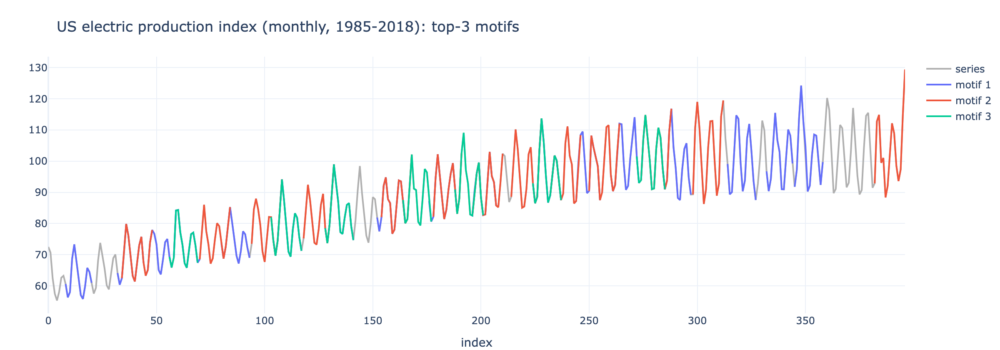
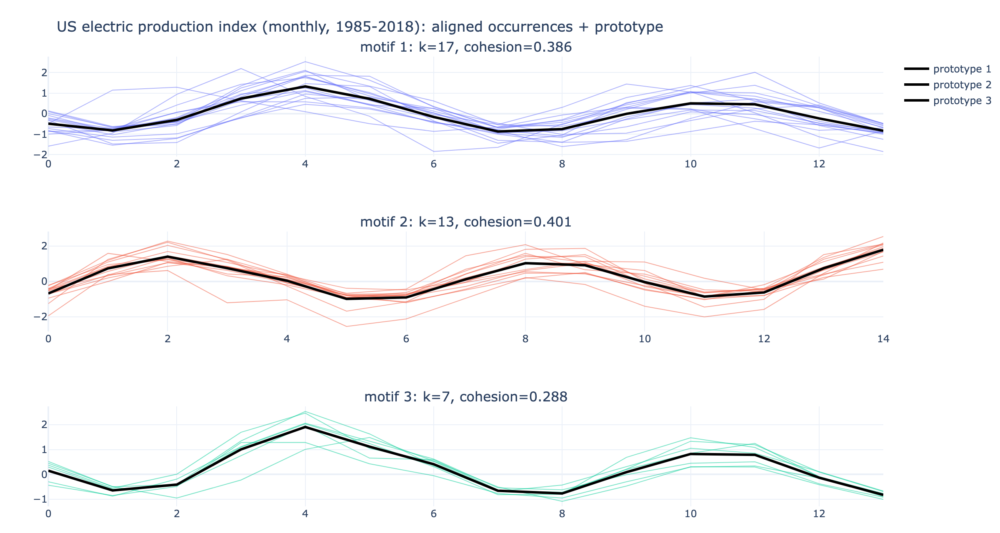
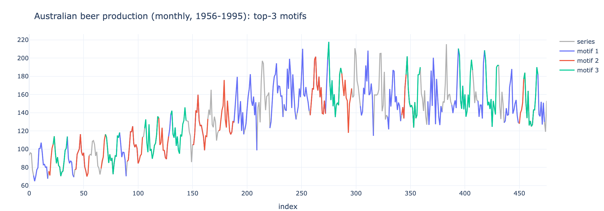
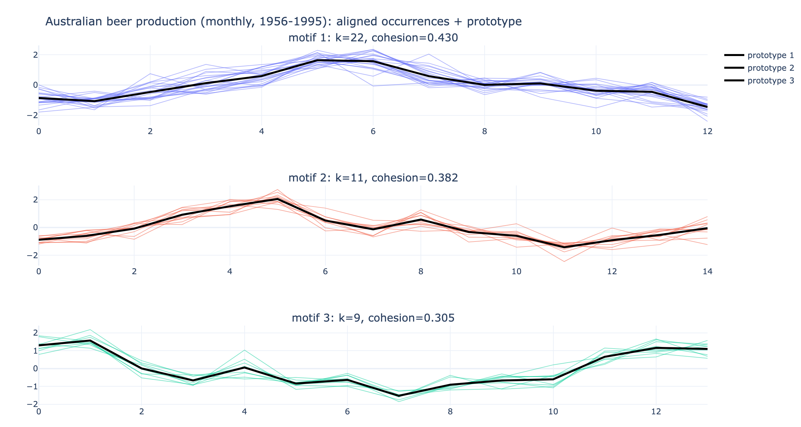

<div align="center">

# 🧬 ditscover

### Discover repeating patterns. Let their length vary.

Unsupervised discovery of variable-length motifs in univariate time series.<br>
A pure Rust engine, a Python API, and interactive Plotly reports.


[Quick start](#-quick-start) ·
[Usage](#-usage) ·
[How it works](#-how-it-works) ·
[Examples](#-example-analyses) ·
[Development](#-development)

</div>

---

A *motif* is a pattern that repeats along a time series—but not always for the same duration. One cycle may last 11 months, the next 13.

`ditscover` finds these patterns **without labels or a fixed window length**. Instead of returning one “best” answer, it discovers distinct motifs and exposes the trade-offs between their frequency, similarity, and length.

| | What you get |
|:--|:--|
| 🔎 Discovery without labels | Find repeated patterns in sensor, demand, production, or physiological data. |
| ↔️ Flexible duration | Match stretched or compressed repetitions, within `max_stretch`. |
| ⚖️ Multi-objective search | Optimize support, cohesion, and length together—without choosing objective weights. |
| 🎲 Reproducible runs | The same seed and configuration produce identical results on 1 or N threads. |
| ⚡ Parallel Rust engine | A reference run with 10,000 points, 200 individuals, and 300 generations took 0.87 s on Apple M4. |
| 🐍 Python and CLI | Explore in a notebook or run YAML-based experiments on a server. |

> ⚠️ **Status:** planted-motif recovery remains an open problem. High-support results can include background windows; inspect the Pareto front and review the [known limitations](#-development) before relying on the selected motifs.

## 🚀 Quick start

Requirements: Rust 1.85+ with edition 2024 support, Python 3.12+, and [uv](https://docs.astral.sh/uv/).

From the repository root:

```bash
uv venv
uv pip install -e '.[dev]'
uv run maturin develop --release
```

This installs the Python package and the `ditscover` command.

Discover motifs and open an interactive report:

```python
import ditscover as ds

res = ds.discover(
    "data/kaggle-electric-production.csv",
    column="IPG2211A2N",
    min_len=9,
    max_len=15,
    preprocess=[{"detrend": "linear"}],
    seed=1,
)

res.plot()  # Self-contained HTML report; works offline.

for motif in res.motifs:
    print(
        motif.support,
        motif.cohesion,
        motif.mean_len,
        motif.occurrences[:3],
    )
```

## 🐍 Usage

**Python API**

- Accepts a CSV/TSV path, NumPy array, list, or pandas Series.
- Accepts configuration fields as keyword arguments using their YAML names: for example, `population=300` or `kind="dtw"`.
- Measures `min_len` and `max_len` on the preprocessed series, while reporting positions in original indices.
- Saves and restores runs with `res.save(directory)` and `ds.load(directory)`.
- Exposes selected motifs through `res.motifs` and the Pareto front through `res.front`.

**Command line**

```bash
# Run a configuration and save to output.dir.
ditscover run configs/electric-production.yaml

# Override settings and generate a report.
ditscover run configs/electric-production.yaml \
  --seed 7 \
  --set population=300 \
  --plot

# Generate a report from a saved run.
ditscover plot results/electric-production
```

Configuration precedence: `defaults → YAML → --set / shortcuts`.

Exit codes: `0` success · `1` data or I/O error · `2` invalid configuration · `130` cancelled. Cancellation still writes the partial result.

<details>
<summary>⚙️ Configuration reference</summary>

Every option and its default is documented in [`config.example.yaml`](specs/001-ga-motif-discovery/contracts/config.example.yaml).

| Group | Main fields |
|:--|:--|
| `data` | `path`, `column` (name or index), `delimiter`, `header` |
| `preprocess` | Ordered steps: `nan`, `detrend`, `smooth`, `normalize`, `paa` |
| `motif` | `min_len`, `max_len`, `max_stretch`, `min_occ`, `max_occ`, `min_gap`, `min_std` |
| `distance` | `kind` (`zeuclid`, `euclid`, or `dtw`), `band` |
| `ga` | `population`, operator probabilities, `scan_step`, `init_greedy`, `niche_jaccard` |
| `stop` | `max_generations`, `time_budget_s`, `stagnation_window`, `stagnation_delta` |
| `output` | `dir`, `top_k`, `dedupe_jaccard`, `snapshot_every` |
| `log` | `level`, `log_every`, `history`, `channel_capacity` |

</details>

<details>
<summary>📦 Saved runs and reports</summary>

Each results folder is self-contained.

| File | Contents |
|:--|:--|
| `results.json` | Top-K motifs, occurrences, prototypes, aligned occurrences, objectives, Pareto front, and stop reason |
| `history.jsonl` | Per-generation hypervolume, front size, best and mean objectives, and front snapshots |
| `config.yaml` | Effective configuration, including the seed |
| `series.csv` | Original series, allowing plots without the source dataset |
| `report.html` | Optional interactive report |

Reports contain four views: motifs on the series, aligned occurrences, optimization history, and the Pareto front by generation.

</details>

## 🧠 How it works

Each candidate motif contains `k` non-overlapping segments, represented as `(start, length)`. NSGA-II evolves these candidates using three objectives:

| Objective | Measures | Goal |
|:--|:--|:--|
| Support | Number of occurrences, `k` | ↑ Maximize |
| Cohesion | Mean distance to the prototype after resampling occurrences to a common length | ↓ Minimize |
| Length | Mean occurrence length | ↑ Maximize |

The result is a Pareto front: competing solutions that expose trade-offs rather than collapsing them into one weighted score.

1. **Initialize:** generate random candidates or seed them with a random window and its best matches.
2. **Vary:** apply donation crossover and shift, stretch, add, or remove mutations.
3. **Repair:** keep candidates valid after variation.
4. **Select:** use NSGA-II and Jaccard-overlap clearing to preserve distinct motifs.
5. **Stop:** finish on the generation limit, time budget, hypervolume stagnation, or Ctrl+C, returning the best result so far.

Distances: z-normalized Euclidean (default), raw Euclidean, or DTW with a Sakoe–Chiba band.

<details>
<summary>🏗️ Architecture and design</summary>


The main discovery path is:

```text
Researcher → Python API / CLI → PyO3 → discover()
                                      ↓
                               Preprocessing
                                      ↓
                                NSGA-II engine
                                      ↓
                               Result → Saved run
```

The engine coordinates operators, evaluation, and survival. A separate logger thread receives non-blocking events and streams them to `history.jsonl`.

An [interactive architecture diagram](.archify/architecture-ditscover-overview-20261003-180638/ditscover-overview.html), generated with Archify, links components to their source lines. Open it in a browser.

Design rules are defined in [the project constitution](.specify/memory/constitution.md):

- Algorithm code lives in `crates/core` and is testable without Python.
- The binding and Python package convert types and delegate execution.
- YAML, CLI, and Python share one serializable `Config` with consistent field names.
- Logging uses a bounded channel and never blocks the genetic algorithm; dropped events are counted.

</details>

<details>
<summary>🗂️ Repository layout</summary>

```text
.
├── Cargo.toml                   # Rust workspace
├── pyproject.toml               # maturin, ruff, pytest
├── crates/
│   ├── core/                    # Pure Rust algorithm
│   │   ├── src/
│   │   │   ├── lib.rs           # Discovery pipeline
│   │   │   ├── config.rs        # Defaults, validation, overrides
│   │   │   ├── io.rs            # Loader trait and CSV loader
│   │   │   ├── preprocess.rs    # NaN, detrend, smooth, normalize, PAA
│   │   │   ├── series.rs        # Series, origin map, prefix statistics
│   │   │   ├── distance.rs      # Resampling, Euclidean, DTW
│   │   │   ├── motif.rs         # Segments, evaluation, prototypes, Jaccard
│   │   │   ├── ops.rs           # Initialization, crossover, mutations, repair
│   │   │   ├── nsga.rs          # Sorting, crowding, clearing, hypervolume
│   │   │   ├── engine.rs        # Evolution loop, RNG, stopping
│   │   │   ├── events.rs        # Event channel and logger
│   │   │   ├── result.rs        # Top-K selection, save/load
│   │   │   └── synth.rs         # Planted motifs and IoU metrics
│   │   ├── tests/               # Rust integration and property tests
│   │   └── benches/ga.rs        # Criterion benchmarks
│   └── py/                      # PyO3 bindings: ditscover._core
├── python/ditscover/             # Python API, CLI, Plotly views
├── tests/python/                # API, CLI, and plot tests
├── configs/                     # Example YAML configurations
├── data/                        # Example datasets
├── results/                     # Saved runs
├── docs/images/                 # README figures
├── scripts/bench_check.py        # Benchmark regression check
├── specs/001-ga-motif-discovery/ # Specification and implementation plan
└── .archify/                    # Interactive architecture diagram
```

</details>

## 📊 Example analyses

Both examples interpolate missing values, remove a linear trend, and apply z-score normalization. Motif lengths range from 9 to 15 months.

| Dataset | Series | Distance | Seed | Top motif |
|:--|:--|:--|:--|:--|
| US electric production | Monthly · 1985–2018 · 397 points | DTW | `42` | 17 occurrences · about 14 months |
| Australian beer production | Monthly · 1956–1995 · 476 points | Z-normalized Euclidean | `69` | 22 occurrences · about 13 months |

**⚡ US electric production**

The discovered motifs capture the yearly cycle with winter and summer peaks. The run stopped after 45 generations due to hypervolume stagnation, taking about 0.1 s.

[Configuration](configs/electric-production.yaml) · [Interactive report](results/electric-production/report.html)



<details>
<summary>View aligned occurrences and prototypes</summary>



</details>

**🍺 Australian beer production**

The top prototype captures an annual rise to a peak followed by a decline. A second motif family contains 11 occurrences of about 15 months and includes a secondary bump.

[Configuration](configs/monthly-beer-production-in-austr.yaml) · [Interactive report](results/monthly-beer-production-in-austr/report.html)



<details>
<summary>View aligned occurrences and prototypes</summary>



</details>

## 🛠️ Development

Run formatting, linting, and tests:

```bash
# Rust
cargo fmt --check
cargo clippy --all-targets -- -D warnings
cargo test

# Python
uv run ruff check
uv run ruff format --check
uv run pytest tests/python
```

Tests cover operator invariants with proptest, determinism across 1 and 4 threads, stopping and cancellation, save/load round trips, allocation-free evaluation, and the Python API, CLI, and plots.

Development follows Spec Kit. See the [specification, plan, research, and tasks](specs/001-ga-motif-discovery/).

<details>
<summary>🧪 Synthetic recovery and benchmarks</summary>

Evaluate recovery across 10 seeds, using 3 planted motifs with 8 occurrences each in a 10,000-point series:

```bash
cargo test -p ditscover-core --release planted -- --nocapture
```

Create a benchmark baseline, compare subsequent runs, and check for regressions above 10%:

```bash
cargo bench -p ditscover-core --bench ga -- --save-baseline ref
cargo bench -p ditscover-core --bench ga -- --baseline ref
python scripts/bench_check.py
```

</details>

**Reference results and limitations**

Results below were measured on Apple M4.

| Check | Result | Target | Status |
|:--|:--|:--|:--|
| Full run: 10,000 points, 200 individuals, 300 generations | 0.87 s | < 30 s | ✅ Met |
| Logging overhead | +0.3% | < 5% | ✅ Met |
| Determinism: 1 vs N threads | Identical results | Identical results | ✅ Met |
| Thread scaling: 8 vs 1 | 2.9× | ≥ 5× | ❌ Not met |
| Planted-motif recovery (SC-001) | Median recall 0.54; precision 0.19 | Recall 0.9; precision 0.8 | ❌ Not met |

> ⚠️ **Recovery:** maximizing support can reward padding real motifs with background windows up to `max_occ`. As a result, top-K selection can favor padded motifs over clean ones.

Resolving this requires changes to the objectives or top-K selection. For now, set `max_occ` close to the expected number of repetitions and inspect `res.front`, not only `res.motifs`.
