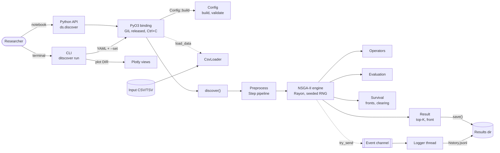

# ditscover

Unsupervised discovery of **variable-length motifs** in univariate time series with a
**multi-objective genetic algorithm** (NSGA-II). The engine is pure Rust, exposed to Python
through PyO3, with a command-line tool and interactive Plotly reports.

A *motif* is a pattern that repeats along a series. In real data each repetition rarely has the
same duration: one yearly cycle may last 11 months and the next 13. `ditscover` finds those
patterns **without labels and without fixing their length in advance**, and returns several
distinct motifs instead of a single "best" one.

## How it helps

- **Find what repeats** in sensor readings, demand, production or physiological signals, with no
  training data.
- **Tolerate stretched repetitions:** occurrences of one motif may differ in length (up to
  `max_stretch`), unlike fixed-window methods.
- **No weights to tune:** support, cohesion and length are optimised together as a Pareto front.
  You get the trade-offs and pick the motif that fits your question.
- **Reproducible:** the same seed and config give identical results on 1 or N threads.
- **Fast and parallel:** 10,000 points × 200 individuals × 300 generations runs in under 1 s on
  an Apple M4.
- **One-line use** from a notebook, or batch runs from YAML on a server.

## How it works

Each individual is a candidate motif: a list of `k` non-overlapping segments `(start, length)`.
NSGA-II evolves the population against three objectives:

| Objective | Meaning | Direction |
|---|---|---|
| Support | number of occurrences `k` | maximise |
| Cohesion | mean distance of each occurrence to the prototype (occurrences resampled to a common length) | minimise |
| Length | mean occurrence length | maximise |

- **Initialisation:** individuals are random or seeded (a random seed window plus its best
  matches found by scanning the series).
- **Variation:** donation crossover (a child absorbs the other parent's occurrences that fit its
  shape) and shift, stretch, add and remove mutations. A `repair` step keeps every individual
  valid.
- **Selection:** NSGA-II with clearing by occurrence overlap (Jaccard), so the population keeps
  several distinct motifs.
- **Distances:** z-normalised Euclidean (default), raw Euclidean, or DTW with a Sakoe-Chiba band.
- **Stopping:** maximum generations, time budget, hypervolume stagnation or Ctrl+C. The best
  result so far is always returned.

## Architecture



A detailed interactive version, with every component linked to its source lines, is in
[`.archify/architecture-ditscover-overview-20261003-180638/ditscover-overview.html`](.archify/architecture-ditscover-overview-20261003-180638/ditscover-overview.html)
(open it in a browser; it was generated with Archify).

Design rules (see [`.specify/memory/constitution.md`](.specify/memory/constitution.md)):

- All algorithm code lives in `crates/core`, testable with `cargo test` and no Python.
- The binding and the Python package only convert types and delegate.
- One serialisable `Config` is shared by YAML, CLI flags and Python kwargs, with the same names.
- Logging goes through a bounded channel and never blocks the GA. When the channel is full,
  events are dropped and counted.

## Repository layout

```text
.
├── Cargo.toml                 # Rust workspace
├── pyproject.toml             # maturin build, ruff, pytest
├── crates/
│   ├── core/                  # ditscover-core: the whole algorithm (pure Rust)
│   │   ├── src/
│   │   │   ├── lib.rs         # discover(): validate → preprocess → engine → result → save
│   │   │   ├── config.rs      # Config, defaults, validation, leaf overrides
│   │   │   ├── io.rs          # Loader trait, CsvLoader
│   │   │   ├── preprocess.rs  # nan / detrend / smooth / normalize / paa steps
│   │   │   ├── series.rs      # Series + origin map, prefix-sum statistics
│   │   │   ├── distance.rs    # resample, z-normalise, Euclidean, DTW
│   │   │   ├── motif.rs       # Segment, Individual, evaluation, prototype, Jaccard
│   │   │   ├── ops.rs         # init, crossover, mutations, repair
│   │   │   ├── nsga.rs        # non-dominated sort, crowding, clearing, 3D hypervolume
│   │   │   ├── engine.rs      # generation loop, deterministic RNG, stop criteria
│   │   │   ├── events.rs      # event channel + logger thread (JSONL, tracing)
│   │   │   ├── result.rs      # top-K, RunResult, save/load
│   │   │   └── synth.rs       # synthetic series with planted motifs + IoU metrics
│   │   ├── tests/             # config, io, invariants (proptest), determinism, planted, ...
│   │   └── benches/ga.rs      # criterion benchmarks
│   └── py/                    # ditscover-py: PyO3 bindings (ditscover._core)
├── python/ditscover/          # Python package: API, CLI, Plotly views
├── tests/python/              # pytest: API, CLI, plots
├── configs/                   # example YAML configurations
├── data/                      # example datasets
├── results/                   # saved runs (one folder per config)
├── docs/images/               # figures used in this README
├── scripts/bench_check.py     # fails if a benchmark regresses > 10 %
├── specs/001-ga-motif-discovery/  # spec, plan, research, data model, contracts, tasks
└── .archify/                  # interactive architecture diagram
```

## Installation

Requirements: Rust (edition 2024, 1.85+), Python ≥ 3.12 and [`uv`](https://docs.astral.sh/uv/).

```bash
uv venv
uv pip install -e '.[dev]'
uv run maturin develop --release
```

This installs the `ditscover` Python package and the `ditscover` command.

## Usage

### Python

```python
import ditscover as ds

res = ds.discover(
    "data/kaggle-electric-production.csv", column="IPG2211A2N",
    min_len=9, max_len=15, preprocess=[{"detrend": "linear"}], seed=1,
)
res.plot()                       # self-contained HTML report (works offline)

for m in res.motifs:             # top-K distinct motifs
    print(m.support, m.cohesion, m.mean_len, m.occurrences[:3])
```

- Input can be a CSV/TSV path, a `numpy` array, a list or a `pandas.Series`.
- Any config field can be passed as a keyword with its YAML name, for example
  `population=300` or `kind="dtw"`.
- `min_len` and `max_len` are measured on the **preprocessed** series. Positions are always
  reported in original indices.
- `res.save(dir)` and `ds.load(dir)` save and restore a run.

### Command line

```bash
ditscover run configs/electric-production.yaml               # writes to output.dir
ditscover run configs/electric-production.yaml --seed 7 --set population=300 --plot
ditscover plot results/electric-production                   # report.html from a saved run
```

Precedence is defaults < YAML < `--set` / shortcuts. Exit codes: `0` ok, `1` data or I/O
error, `2` invalid config, `130` cancelled (the partial result is still written).

### Configuration

Every option is documented with its default in
[`specs/001-ga-motif-discovery/contracts/config.example.yaml`](specs/001-ga-motif-discovery/contracts/config.example.yaml).
Main groups:

| Group | Key fields |
|---|---|
| `data` | `path`, `column` (name or index), `delimiter`, `header` |
| `preprocess` | ordered list of `nan`, `detrend`, `smooth`, `normalize`, `paa` |
| `motif` | `min_len`, `max_len`, `max_stretch`, `min_occ`, `max_occ`, `min_gap`, `min_std` |
| `distance` | `kind: zeuclid \| euclid \| dtw`, `band` |
| `ga` | `population`, operator probabilities, `scan_step`, `init_greedy`, `niche_jaccard` |
| `stop` | `max_generations`, `time_budget_s`, `stagnation_window`, `stagnation_delta` |
| `output` | `dir`, `top_k`, `dedupe_jaccard`, `snapshot_every` |
| `log` | `level`, `log_every`, `history`, `channel_capacity` |

### Output

A results folder is self-contained:

| File | Content |
|---|---|
| `results.json` | top-K motifs (occurrences, prototype, aligned occurrences, objectives), Pareto front, stop reason |
| `history.jsonl` | one line per generation: hypervolume, front size, best and mean objectives, front snapshots |
| `config.yaml` | effective configuration, including the seed |
| `series.csv` | original series, so plots work without the source data |
| `report.html` | optional report with 4 views: motifs on the series, aligned overlay, evolution, Pareto front by generation |

## Example analyses

Both runs use the configs in [`configs/`](configs). The preprocessing is: interpolate missing
values, remove a linear trend, z-score. Motif lengths range from 9 to 15 months.

### US electric production (monthly, 1985–2018, 397 points)

[`configs/electric-production.yaml`](configs/electric-production.yaml) (DTW distance, seed 42):


The motifs pick up the yearly cycle with its winter and summer peaks. The top motif has 17
occurrences of about 14 months. The run stopped on hypervolume stagnation after 45 generations
(about 0.1 s). Full report: [`results/electric-production/report.html`](results/electric-production/report.html).

### Australian beer production (monthly, 1956–1995, 476 points)

[`configs/monthly-beer-production-in-austr.yaml`](configs/monthly-beer-production-in-austr.yaml)
(z-normalised Euclidean, seed 69):


The top motif has 22 occurrences of about 13 months. Its prototype shows the annual rise to a
peak followed by a decline. A second family of 11 occurrences, about 15 months long, adds a
secondary bump. Full report:
[`results/monthly-beer-production-in-austr/report.html`](results/monthly-beer-production-in-austr/report.html).

## Development

```bash
cargo fmt --check && cargo clippy --all-targets -- -D warnings && cargo test
uv run ruff check && uv run ruff format --check && uv run pytest tests/python
```

- **Tests:**
  - property tests of the operator invariants (proptest);
  - determinism with 1 vs 4 threads;
  - stop criteria and cancellation;
  - save/load round trip;
  - an allocation-counting test proving the evaluation hot loop never allocates;
  - pytest for the API, CLI and plots.
- **Quality on synthetic data:** `cargo test -p ditscover-core --release planted -- --nocapture`
  plants 3 motifs × 8 occurrences in 10,000 points and reports recall and precision for 10 seeds.
- **Benchmarks:** `cargo bench -p ditscover-core --bench ga -- --save-baseline ref` once, then
  `--baseline ref` and `python scripts/bench_check.py` to fail on any regression above 10 %.

Development follows Spec Kit: see [`specs/001-ga-motif-discovery/`](specs/001-ga-motif-discovery)
for the specification, plan, research decisions and tasks.

## Status and known limitations

| Target | Result on the reference machine (Apple M4) |
|---|---|
| Full run, 10⁴ points, 200 × 300 | 0.87 s (target < 30 s) ✅ |
| Logging overhead | +0.3 % (target < 5 %) ✅ |
| Same seed, 1 vs N threads | identical results ✅ |
| Thread scaling, 8 vs 1 | 2.9× (target ≥ 5×) ❌ |
| Planted-motif recovery (SC-001) | median recall 0.54, precision 0.19 (target 0.9 / 0.8) ❌ |

Planted-motif recovery is the open problem. Maximising support rewards padding a real motif with
background windows up to `max_occ`, so the top-K list prefers padded motifs over the clean ones.
Fixing it requires a change to the objectives or to the top-K selection. Until then, set
`max_occ` close to the number of repetitions you expect, and inspect the Pareto front
(`res.front`), not only `res.motifs`.
