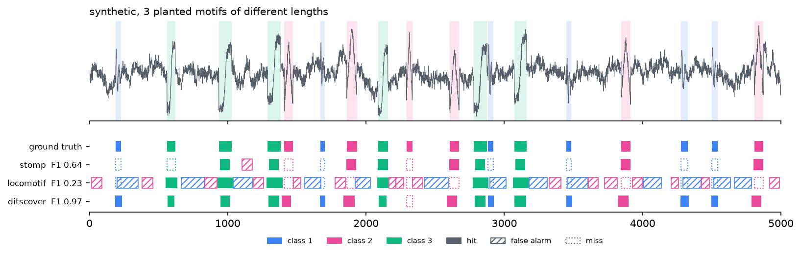
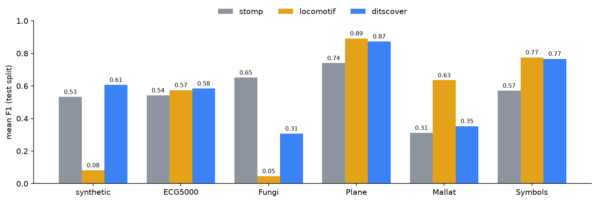
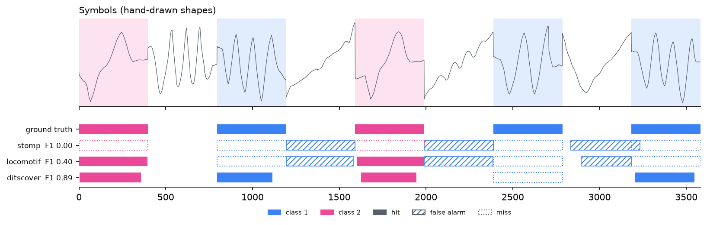
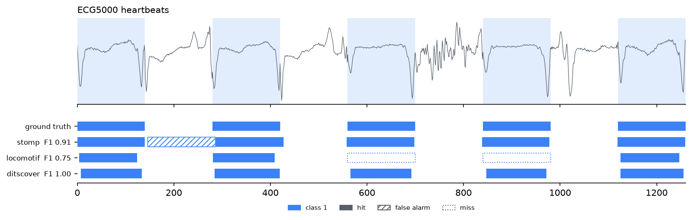
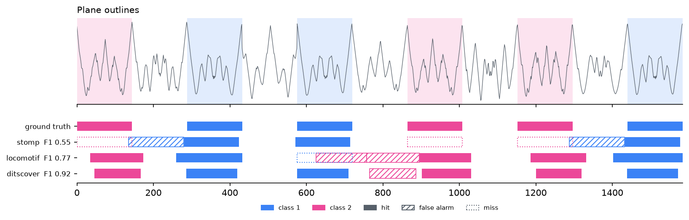
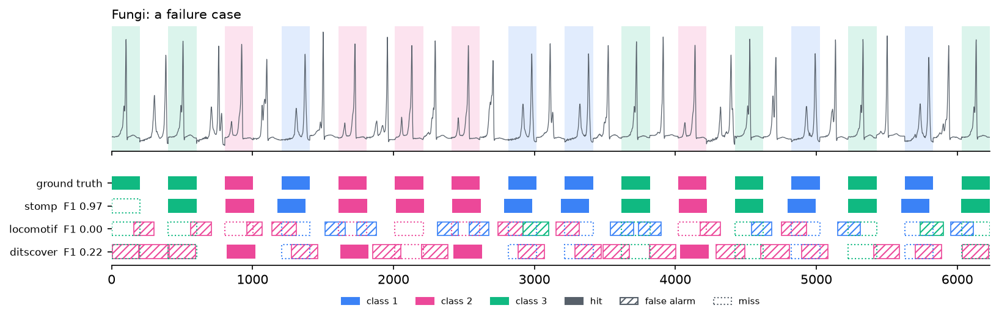
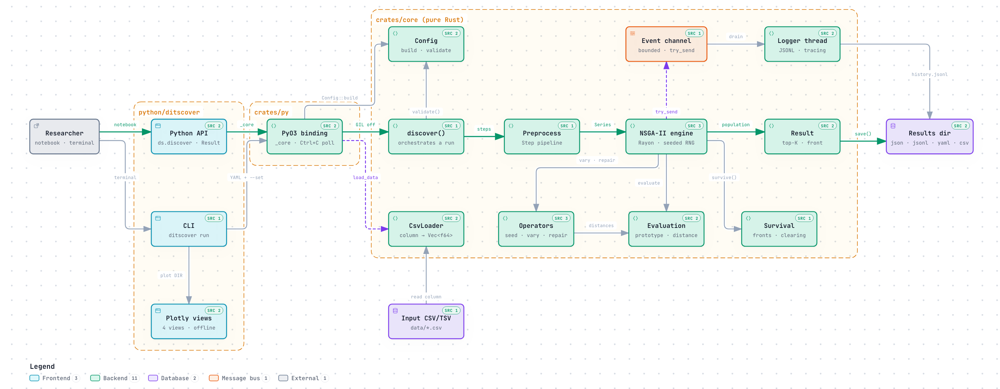

<div align="center">

# ditscover

**Unsupervised discovery of variable-length motifs in time series with multi-objective evolutionary search**

<br>


<br>

[Overview](#overview) ·
[Results](#results-at-a-glance) ·
[Installation](#installation) ·
[Quick start](#quick-start) ·
[Method](#method) ·
[Benchmark](#benchmark) ·
[Configuration](#configuration) ·
[Reproducibility](#reproducibility-and-performance) ·
[Development](#development) ·
[Citing](#citing)

<br>



<sub>Labelling of a held-out synthetic series with three planted motifs whose occurrences vary in
duration. Filled: correct window and class; hatched: false alarm; dotted: miss.</sub>

</div>

## Overview

A **motif** is a pattern that recurs along a time series. In real signals, recurrences are rarely
identical in duration — a seasonal cycle lasts eleven months one year and thirteen the next, a
gesture is drawn faster or slower. Methods built on a fixed window length either miss these
occurrences or cut them at the wrong boundaries.

`ditscover` treats motif discovery as a **multi-objective optimisation problem over sets of
variable-length segments**. Each candidate motif is a set of non-overlapping occurrences, each with
its own start and length. A Rust engine evolves these sets with NSGA-II, a leave-one-out notion of
similarity, memetic boundary refinement and nearest-neighbour seeding, and then returns a small
number of distinct motifs together with a conflict-free labelling of the series. No labels, no
training data and no window length are required.

**Highlights**

- **Variable duration by construction.** Occurrences of one motif may differ in length (bounded by
  `max_stretch`); they are compared after resampling to a common length.
- **No weighted score.** Support, extent and cohesion are optimised jointly; the Pareto front is
  exposed alongside the selected motifs.
- **Closed motif sets.** Final motifs are ranked by how clearly their occurrences separate from the
  nearest non-member window of the series (margin), not by raw occurrence count.
- **Labelling, not only motifs.** Every time point is assigned to at most one motif.
- **Reproducible and parallel.** Identical seed and configuration give identical results on 1 or N
  threads; evaluation runs in parallel with Rayon.
- **Research tooling included.** PROM evaluation, a benchmark harness against Matrix Profile (STOMP)
  and LoCoMotif with validation tuning and paired statistical tests, and offline HTML reports.

## Results at a glance

Mean PROM F1 on held-out test series (20 per dataset; ditscover averaged over 3 seeds; baselines
tuned on a separate validation split). Best mean per row in bold.

| Dataset | STOMP | LoCoMotif | ditscover |
| :--- | ---: | ---: | ---: |
| Synthetic, variable length | 0.53 | 0.08 | **0.61** |
| ECG5000 | 0.54 | 0.57 | **0.58** |
| Plane | 0.74 | **0.89** | 0.87 |
| Symbols | 0.57 | **0.78** | 0.77 |
| Mallat | 0.31 | **0.64** | 0.35 |
| Fungi | **0.65** | 0.05 | 0.31 |
| Mean rank (lower is better) | 2.08 | 2.03 | **1.89** |

`ditscover` has the best mean rank and is the only method that is never last on any dataset. It is
significantly below the best baseline on Fungi and Mallat; see [Benchmark](#benchmark) for the full
protocol, dispersion, significance tests and failure analysis.



## Installation

`ditscover` is built from source with [maturin](https://www.maturin.rs/). Requirements: a Rust
toolchain supporting edition 2024 (1.85+), Python 3.12+ and [uv](https://docs.astral.sh/uv/).

```bash
git clone https://github.com/cardlophin/ditscovery.git && cd ditscovery
uv venv
uv pip install -e '.[dev]'
uv run maturin develop --release
```

Optional extras:

| Extra | Adds | Needed for |
| :--- | :--- | :--- |
| `bench` | `stumpy`, `dtai-locomotif`, `scipy` | `ditscover bench`, baselines, statistical tests |
| `finance` | `yfinance`, `pandas` | Yahoo Finance data sources |

```bash
uv pip install -e '.[dev,bench,finance]'
```

## Quick start

### Python

```python
import ditscover as ds

res = ds.discover(
    "data/kaggle-electric-production.csv",
    column="IPG2211A2N",
    min_len=9, max_len=15,          # in points of the preprocessed series
    preprocess=[{"nan": "interpolate"}, {"detrend": "linear"}, {"normalize": "zscore"}],
    top_k="auto",                   # every closed motif set (positive margin)
    seed=42,
)

for m in res.motifs:
    print(m.support, m.mean_len, m.margin, m.occurrences[:3])

res.labels        # one motif index per original time point (-1 = none)
res.front         # the full Pareto front
res.plot()        # self-contained interactive HTML report
res.save("results/electric")
```

Inputs may be CSV/TSV paths, NumPy arrays, lists or pandas Series. Every configuration field can be
passed as a keyword argument using its YAML name (`population=300`, `kind="zdtw"`). Occurrence
positions are always reported in **original** indices, whatever the preprocessing.

### Command line

```bash
ditscover run configs/electric-production.yaml --plot          # discover, save, report
ditscover run configs/electric-production.yaml --seed 7 --set population=300
ditscover run --ticker ^GSPC --start 2015-01-01 --end 2025-01-01 --interval 1wk \
              --set min_len=8 --set max_len=26 --plot          # requires the finance extra
ditscover plot results/electric-production                     # report from a saved run
```

Configuration precedence is `defaults < YAML < --set / shortcuts`. Exit codes: `0` success, `1`
data or I/O error, `2` invalid configuration, `130` cancelled (the partial result is still saved).

### Example: US electric production (1985–2018, monthly)

With [`config.v2.example.yaml`](specs/003-motif-quality/contracts/config.v2.example.yaml)
(z-normalised Euclidean distance, lengths 9–15, `max_stretch` 1.3, `top_k: auto`) the run stops
after 100 generations (0.2 s) and returns two closed motif sets:

| Motif | Occurrences | Duration | Margin | Interpretation |
| :--- | ---: | :--- | ---: | :--- |
| 1 | 8 | 13 months | 0.48 | A full annual cycle from one December to the next; all eight occurrences start in December |
| 2 | 3 | 9 months | 0.30 | January to September of 1998, 2002 and 2005 |

Both motifs are aligned with the calendar although the method never sees dates.

## Method

### Problem formulation

Let $x \in \mathbb{R}^n$ be a univariate series. A candidate motif is a set of $k$ non-overlapping
segments

```math
M = \{(s_i, \ell_i)\}_{i=1}^{k}, \qquad \ell_{\min} \le \ell_i \le \ell_{\max}, \qquad
\frac{\max_i \ell_i}{\min_i \ell_i} \le \rho, \qquad k_{\min} \le k \le k_{\max}.
```

Each segment is resampled to the common length $L^* = \mathrm{round}(\bar{\ell})$, giving vectors
$v_1,\dots,v_k$ (z-normalised for `zeuclid` and `zdtw`). The genotype *is* this list of segments,
so the search acts directly on what the user interprets. Every operator ends with a repair step, so
the population never contains infeasible motifs.

### Objectives

Member distances are **leave-one-out**: each occurrence is compared with the prototype of the
*other* occurrences, which removes the optimistic bias of small sets and penalises outliers.

```math
p_{-i} = \frac{k\,\bar{v} - v_i}{k - 1}, \qquad d_i = D(v_i, p_{-i}).
```

For DTW distances the prototype is the medoid of the set. NSGA-II minimises three objectives
without weights:

| | Objective | Definition | Direction |
| :---: | :--- | :--- | :---: |
| $f_1$ | Support | number of occurrences $k$ | maximise |
| $f_2$ | Extent | $q$-quantile of $\{d_i\}$ (default $q = 0.9$) | minimise |
| $f_3$ | Cohesion | mean of $\{d_i\}$ | minimise |

Adding a weak occurrence raises the extent immediately, so support cannot grow at the expense of
similarity.

### Ranking: closed motif sets

A motif is useful when its occurrences are closer to each other than to anything else in the
series. Let $d_{\text{out}}$ be the distance from the prototype to the nearest admissible window
that is not an occurrence (found with a PAA candidate index and exact refinement), $E$ the extent,
$\delta(L^*)$ the median distance between random window pairs of that length, and $c$ the fraction
of the series covered by the motif. Final motifs are ranked by

```math
\mu = \frac{d_{\text{out}} - E}{\max(d_{\text{out}}, E)}, \qquad
Q = \sqrt{c}\;\cdot\;\max(\mu, 0)\;\cdot\;\max\!\left(1 - \frac{E}{\delta(L^*)},\, 0\right).
```

Only motifs with a positive margin $\mu$ are considered closed; `top_k: auto` returns exactly those.

### Search

1. **Initialisation**: nearest-neighbour seeds from the candidate index, grown until the largest
   relative jump in sorted distances; greedy seeds (a random window and its best matches); random
   sets.
2. **Variation**: donation crossover (a child absorbs the other parent's occurrences that fit its
   prototype); shift, stretch, add and remove mutations. Additions are *guarded*: accepted only if
   the extent does not increase.
3. **Boundary refinement** (memetic): coordinate descent on the start and length of each
   occurrence to minimise its leave-one-out distance.
4. **Survival**: NSGA-II with clearing — motifs whose coverage overlaps a better one are relegated,
   preserving several motif families.
5. **Stopping**: generation limit, time budget, hypervolume stagnation after a minimum number of
   generations, or user cancellation (the best result so far is returned).

### Selection and labelling

Candidates are ranked by $Q$; a candidate is discarded as a duplicate if most of its coverage is
contained in a better motif or if its prototype matches a better one up to a small lag. Occurrences
of the chosen motifs are then made **conflict-free** by maximum-weight interval scheduling, which
produces the per-point labelling.

### Distances

| `kind` | Description |
| :--- | :--- |
| `zeuclid` | Z-normalised Euclidean (default) |
| `euclid` | Euclidean on raw values |
| `dtw` | Dynamic time warping, Sakoe–Chiba band |
| `zdtw` | DTW on z-normalised windows, medoid prototype |

A complexity-invariant correction (`cid: true`) is available for all distances.

## Benchmark

### Protocol

| | |
| :--- | :--- |
| **Methods** | STOMP via [stumpy](https://github.com/TDAmeritrade/stumpy) (fixed window); [LoCoMotif](https://github.com/ML-KULeuven/locomotif) (variable length, time-warped); `ditscover` with library defaults |
| **Data** | Synthetic suite with three planted motifs (lengths 40, 60, 80, stretched by up to ±30 %, Gaussian noise); the five univariate datasets of TSMD-Bench: ECG5000, Fungi, Plane, Mallat, Symbols |
| **Splits** | Baseline hyper-parameters tuned on a validation split; 20 unseen test series per dataset evaluated once |
| **Information** | Every method receives the true number of motif sets and the same length window |
| **Metric** | PROM F1: occurrences match at IoU > 0.5, motif sets are matched to true sets by optimal assignment |
| **Statistics** | Paired Wilcoxon signed-rank tests over series (seeds averaged), Holm-corrected |

### Results

| Dataset | STOMP | LoCoMotif | ditscover | Significance (Holm) |
| :--- | ---: | ---: | ---: | :--- |
| Synthetic | 0.53 ± 0.15 | 0.08 ± 0.07 | **0.61 ± 0.24** | > LoCoMotif (p < 0.001); ≈ STOMP |
| ECG5000 | 0.54 ± 0.29 | 0.57 ± 0.21 | **0.58 ± 0.20** | ≈ both |
| Plane | 0.74 ± 0.12 | **0.89 ± 0.11** | 0.87 ± 0.16 | ≈ LoCoMotif |
| Symbols | 0.57 ± 0.32 | **0.78 ± 0.18** | 0.77 ± 0.19 | ≈ LoCoMotif |
| Mallat | 0.31 ± 0.28 | **0.64 ± 0.24** | 0.35 ± 0.27 | < LoCoMotif (p < 0.001) |
| Fungi | **0.65 ± 0.22** | 0.05 ± 0.07 | 0.31 ± 0.33 | < STOMP (p < 0.001) |

<sub>Mean F1 ± standard deviation. "≈" denotes no significant difference at α = 0.05.</sub>

Median run time per series is 0.5–1.2 s for `ditscover`: faster than LoCoMotif on the synthetic
suite and on Mallat (1.1 s vs 5.3 s), slower on the short TSMD series, where LoCoMotif needs well
under a second and STOMP a few milliseconds.

### Labelling examples

<table>
<tr>
<td width="50%"><br><sub><b>Symbols.</b> Hand-drawn shapes of different durations; STOMP's fixed window cannot follow them.</sub></td>
<td width="50%"><br><sub><b>ECG5000.</b> Heartbeat classes with subtle shape differences.</sub></td>
</tr>
<tr>
<td width="50%"><br><sub><b>Plane.</b> Outline profiles; ditscover and LoCoMotif are on par.</sub></td>
<td width="50%"><br><sub><b>Fungi (failure case).</b> Near-identical spikes packed back to back.</sub></td>
</tr>
</table>

### Known limitations

- **Densely packed, near-identical motifs (Fungi).** Conflict-free labelling discards correct but
  overlapping occurrences and places windows between true ones; STOMP is clearly better here.
- **Very long motifs (Mallat, ≈ 1 000 points).** LoCoMotif is clearly ahead; the cause has not yet
  been isolated.
- **Planted-motif recovery** on 10 000-point series reaches a median recall and precision of about
  0.63, short of the 0.9 / 0.8 targets set in feature 001.

### Reproduce

```bash
uv pip install -e '.[dev,bench]'
ditscover bench specs/003-motif-quality/contracts/final.example.yaml --out results/bench-003 --plot
```

`results/bench-003/report.html` contains summary, quality, cost and per-series error views. The
corrected baseline, the ablation study (19 440 runs) and the final evaluation are documented in
[`specs/003-motif-quality/research.md`](specs/003-motif-quality/research.md).

## Configuration

YAML files, CLI flags and Python keyword arguments share one validated configuration model.
Annotated example: [`config.v2.example.yaml`](specs/003-motif-quality/contracts/config.v2.example.yaml).

| Section | Fields |
| :--- | :--- |
| `data` | `path`, `column`, `delimiter`, `header`, `time_column`; or `ticker`, `start`, `end`, `period`, `interval`, `field`, `refresh` |
| `preprocess` | Ordered steps: `nan` (interpolate, ffill, drop), `detrend` (linear, diff), `smooth`, `normalize` (zscore, minmax), `paa` |
| `motif` | `min_len`, `max_len`, `max_stretch`, `min_occ`, `max_occ`, `min_gap`, `min_std` |
| `distance` | `kind` (`zeuclid`, `euclid`, `dtw`, `zdtw`), `band` |
| `fitness` | `extent_q`, `null_pairs`, `cid`, `loo` |
| `ga` | `population`, `crossover`, `shift`, `stretch`, `add`, `remove`, `sigma_shift`, `sigma_stretch`, `scan_step`, `init_greedy`, `niche_jaccard`, `refine`, `refine_radius`, `guarded_add`, `seed_nn` |
| `stop` | `max_generations`, `min_generations`, `time_budget_s`, `stagnation_window`, `stagnation_delta` |
| `output` | `dir`, `top_k` (integer or `auto`), `dedupe_overlap`, `dedupe_shape`, `labels`, `snapshot_every` |
| `log` | `level`, `log_every`, `history`, `channel_capacity` |

### Outputs

| File | Contents |
| :--- | :--- |
| `results.json` | Selected motifs (occurrences, prototype, aligned occurrences, support, extent, cohesion, margin, coverage, quality), Pareto front, stop reason, version |
| `history.jsonl` | Per generation: hypervolume, front size, best and mean objectives, periodic front snapshots |
| `config.yaml` | Effective configuration, including the seed |
| `series.csv` | Original series, timestamps when available, and the motif label of each point |
| `report.html` | Self-contained report: summary, motif table, motifs, evolution and Pareto front |

Benchmark folders add `runs.csv`, `sets.jsonl` (every discovered set), `summary.json` (aggregates,
tuned parameters, paired tests) and `bench.yaml`.

## Reproducibility and performance

Reference measurements on an Apple M-series laptop.

| Check | Result |
| :--- | :--- |
| Same seed, 1 vs N threads | Identical results |
| Defaults, 20 000 points | ≈ 2 s per run (target < 10 s) |
| 10 000 points, population 200, 300 generations (feature 001 engine) | 0.87 s |
| Logging overhead | +0.3 % (non-blocking event channel) |
| Overlapping occurrences across returned motifs | 0 in 360 benchmark runs |
| Thread scaling, 8 vs 1 threads | 2.9× (target ≥ 5×, not met) |

All randomness derives from `(seed, generation, index)` streams, so results do not depend on thread
scheduling. Every saved run records its effective configuration and library version.

## Development

### Design principles

- **The algorithm lives in Rust.** `crates/core` contains all algorithmic code and is tested without
  Python; the PyO3 bindings and the Python package only convert types and delegate.
- **One configuration model** shared by YAML, CLI and Python, validated in one place.
- **Observability without interference.** The engine emits events to a bounded channel and never
  blocks on logging; dropped events are counted.
- **Evidence-driven changes.** Algorithmic components are adopted only after an ablation study;
  components without measurable benefit are deleted.

The full rules are in the [project constitution](.specify/memory/constitution.md).

### Checks

```bash
cargo fmt --check && cargo clippy --all-targets -- -D warnings && cargo test
uv run ruff check && uv run ruff format --check && uv run pytest
```

The test suite covers operator invariants (property-based, `proptest`), determinism across thread
counts, stop criteria and cancellation, save/load round trips, allocation-free evaluation, PROM
against brute force, labelling optimality, and the Python API, CLI and reports.

<details>
<summary>Repository layout</summary>

```text
crates/core/src/
  lib.rs          discovery pipeline            config.rs     configuration and validation
  io.rs           loaders                       preprocess.rs preprocessing steps
  series.rs       series, index map, stats      distance.rs   resampling, Euclidean, DTW, CID
  motif.rs        segments, prototypes          fitness.rs    leave-one-out distances, objectives, quality
  index.rs        PAA candidate index           ops.rs        initialisation, variation, refinement, repair
  nsga.rs         sorting, crowding, clearing   engine.rs     evolution loop, RNG streams, stopping
  label.rs        conflict-free labelling       result.rs     ranking, deduplication, save/load
  metrics.rs      PROM                          bench.rs      benchmark configuration
  events.rs       event channel, logger         synth.rs      planted-motif generator
crates/py/        PyO3 bindings (ditscover._core)
python/ditscover/ Python API, CLI, Yahoo Finance source, reports, benchmark harness
tests/python/     API, CLI, benchmark and report tests
configs/          example configurations
specs/            Spec Kit specifications, plans, research notes and tasks
```

</details>

<details>
<summary>Architecture</summary>



An interactive version that links components to source lines is available in
[`.archify/`](.archify/architecture-ditscover-overview-20261003-180638/ditscover-overview.html).

</details>

### Development history

Development follows spec-driven development with [Spec Kit](https://github.com/github/spec-kit).
Each feature has its specification, plan, research decisions and tasks:

| Feature | Scope |
| :--- | :--- |
| [`001-ga-motif-discovery`](specs/001-ga-motif-discovery/) | Engine, Python API, CLI, reports |
| [`002-benchmark-metrics`](specs/002-benchmark-metrics/) | PROM, baselines, benchmark harness, dashboards, Yahoo Finance |
| [`003-motif-quality`](specs/003-motif-quality/) | Leave-one-out fitness, closed-set ranking, refinement, labelling, ablation |

## Citing

If you use `ditscover` in academic work, please cite the software:

```bibtex
@software{ditscover,
  title   = {ditscover: unsupervised discovery of variable-length time series motifs
             with multi-objective evolutionary search},
  author  = {{ditscover contributors}},
  year    = {2026},
  version = {0.1.0},
  url     = {https://github.com/cardlophin/ditscovery}
}
```

## References

- K. Deb, A. Pratap, S. Agarwal, T. Meyarivan. *A fast and elitist multiobjective genetic
  algorithm: NSGA-II.* IEEE Transactions on Evolutionary Computation, 6(2), 2002.
- Y. Zhu et al. *Matrix Profile II: Exploiting a novel algorithm and GPUs to break the one hundred
  million barrier for time series motifs and joins.* IEEE ICDM, 2016.
- S. M. Law. *STUMPY: A powerful and scalable Python library for time series data mining.* Journal
  of Open Source Software, 4(39), 2019.
- D. Van Wesenbeeck, A. Yurtman, W. Meert, H. Blockeel. *LoCoMotif: discovering time-warped motifs
  in time series.* Data Mining and Knowledge Discovery, 2024.
- D. Van Wesenbeeck, A. Yurtman, W. Meert, H. Blockeel. *Quantitative evaluation of motif sets in
  time series.* Data Mining and Knowledge Discovery, 2025.
- G. E. Batista, E. J. Keogh, O. M. Tataw, V. M. de Souza. *CID: an efficient complexity-invariant
  distance for time series.* Data Mining and Knowledge Discovery, 28(3), 2014.
- E. Keogh, K. Chakrabarti, M. Pazzani, S. Mehrotra. *Dimensionality reduction for fast similarity
  search in large time series databases.* Knowledge and Information Systems, 3(3), 2001.
- A. Pétrowski. *A clearing procedure as a niching method for genetic algorithms.* IEEE ICEC, 1996.
